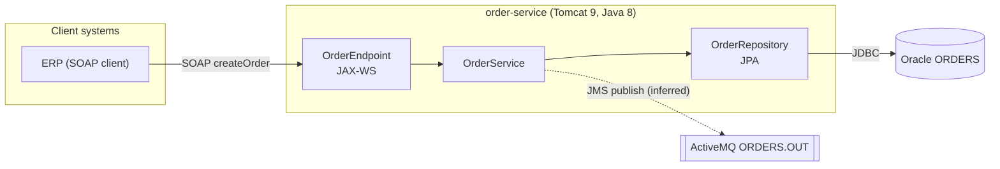

# Markdown Diagram Writer Skill

Use this skill when the user asks to draw or update a diagram in Markdown: system context, component or module maps, request/message flows, class models, JPA entity relationships, state machines, deployment views, or Java 8 to Java 21 migration plans.

## Goal

Produce small, correct, evidence-based diagrams that render in GitHub, GitLab, Confluence (Mermaid macro), IntelliJ, and VS Code, and that a reviewer can check against the code.

## Choose The Diagram

| Question the reader has | Mermaid type |
| --- | --- |
| What talks to what, across system boundaries? | `flowchart LR` with one `subgraph` per boundary (C4 context/container style) |
| What happens, in order, for one request or message? | `sequenceDiagram` |
| How are the main types related? | `classDiagram` |
| What does the persistence model look like? | `erDiagram` |
| Which states can an entity or job move through? | `stateDiagram-v2` |
| Which decisions or steps does a process follow? | `flowchart TD` |
| Which migration slices run in which order? | `gantt` or `flowchart LR` |
| Where does each artifact run? | `flowchart` with one `subgraph` per host, container, or JVM |

Choose one question per diagram. When the request covers several questions, draw several small diagrams instead of one large one.

## Evidence Rules

- Derive every node and edge from the code, the build files, or the configuration: `pom.xml`, `web.xml`, Spring XML or `@Configuration`, `persistence.xml`, JPA annotations, JMS listeners, WSDL/XSD, `application.properties`, and Dockerfiles.
- Under the diagram, list the source files that justify the diagram as `path:line` references.
- Mark inferred or unverified elements explicitly, for example with a dashed edge `-.->` and the note "inferred".
- Do not invent components, queues, tables, or endpoints. If the evidence is missing, say so and ask.
- For migration diagrams, show the current state and the target state as separate diagrams, or as two clearly labeled subgraphs.

## Mermaid Authoring Rules

- Keep each diagram to about 15 nodes. Split the diagram or group nodes in a `subgraph` when it grows larger.
- Use stable, short node IDs (`orderSvc`) with readable labels (`orderSvc["Order Service Spring 4 / Java 8"]`).
- Put labels that contain spaces, parentheses, slashes, colons, or `@` in double quotes.
- Do not use `end` as a node ID. Avoid `o` and `x` as the first letter of a node ID that follows `--`, because Mermaid reads them as edge markers.
- Label every edge that carries meaning: protocol, queue name, or operation (`-->|"SOAP getOrder"|`, `-->|"JMS ORDERS.IN"|`).
- Use one direction per diagram (`LR` for systems and pipelines, `TD` for processes).
- Do not hard-code colors or themes. Optional semantic classes are allowed, for example `classDef legacy stroke-dasharray: 5 5`, with a short legend.
- Write the diagram in a fenced code block with the `mermaid` language tag.

## ASCII Fallback

Add a plain-text version in a `text` code block when the target renderer has no Mermaid support (some Confluence pages, plain terminals, commit messages) or when the user asks for one. Use only ASCII box characters (`+ - | > v`) so that the drawing aligns in every font.

## Placement

- Put architecture diagrams in the target project's existing docs location. When the project has no docs location, use `docs/diagrams/<topic>.md`.
- When a diagram describes stable project architecture, add a link or a short summary to `opencode/memory/architecture.md` through the `project-architecture-memory-writer` skill. Do not duplicate the diagram there.
- Update an existing diagram in place. Do not create a parallel copy of it.
- Do not modify production code.

## Validation

- Re-read the Mermaid source and check the syntax: balanced brackets and quotes, valid arrow syntax, and a valid diagram type on the first line.
- If the Mermaid CLI is available and the project allows it, render the diagram to check it: `npx -y @mermaid-js/mermaid-cli -i <file>.md -o /tmp/diagram-check.md`. If rendering was not possible, say so.
- Check each node and edge against the cited evidence before you report the diagram as complete.

## Example

Sources: `src/main/java/.../OrderEndpoint.java:12`, `src/main/resources/META-INF/persistence.xml:5`.

## Required Output

Return:

1. The diagram or diagrams, in Markdown.
2. The evidence list (`path:line`) and any inferred elements.
3. The files changed, if the diagram was written to a file.
4. Open questions and gaps in the evidence.
